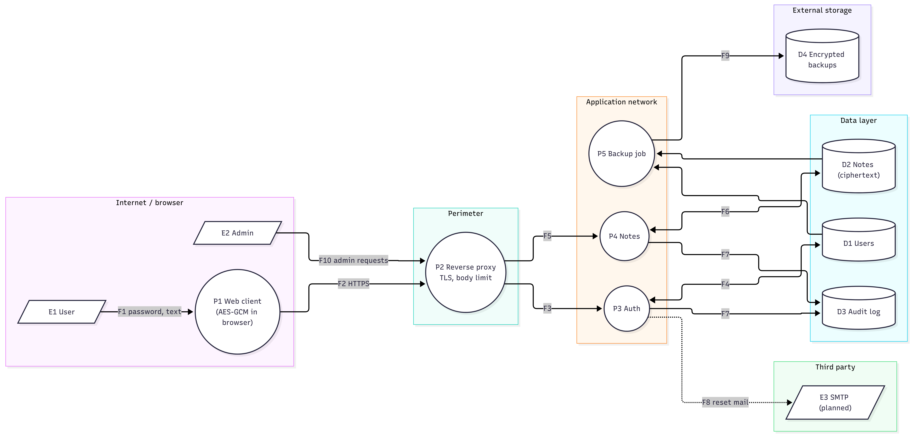
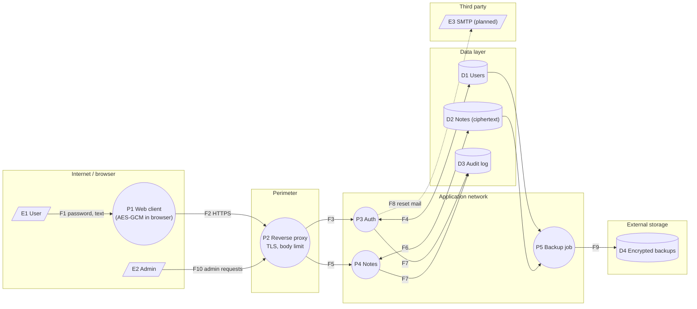

# Data flow diagram (level 1)

Trust boundaries: TB1 internet/browser | perimeter, TB2 perimeter | application network, TB3 application | data layer,
TB4 system | third-party SMTP, TB5 data layer | external backup storage.
Secure-by-design annotations: see `assets-and-gaps.md`.

